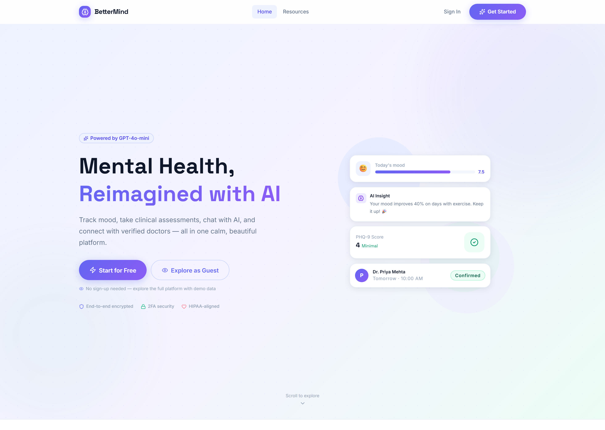
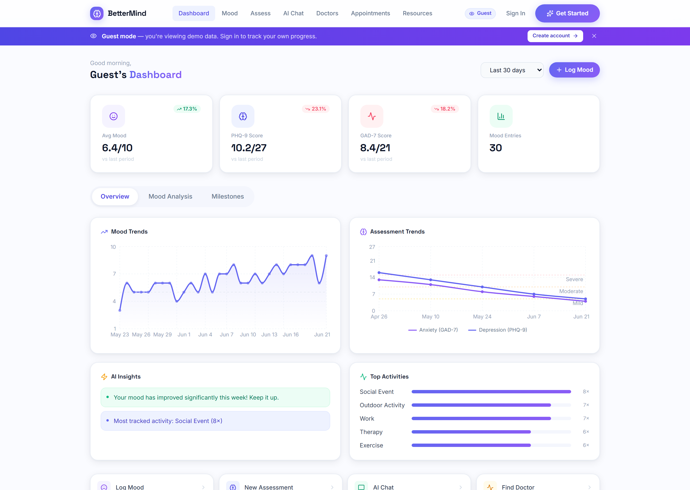
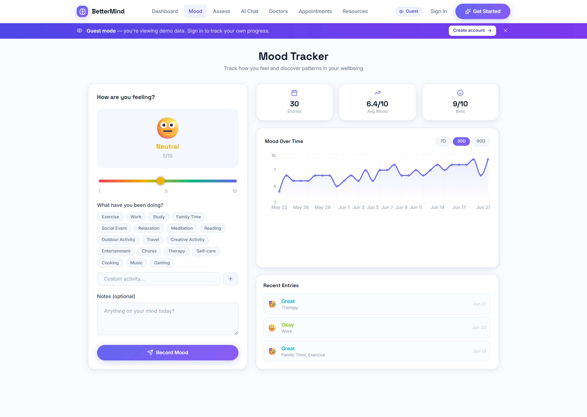
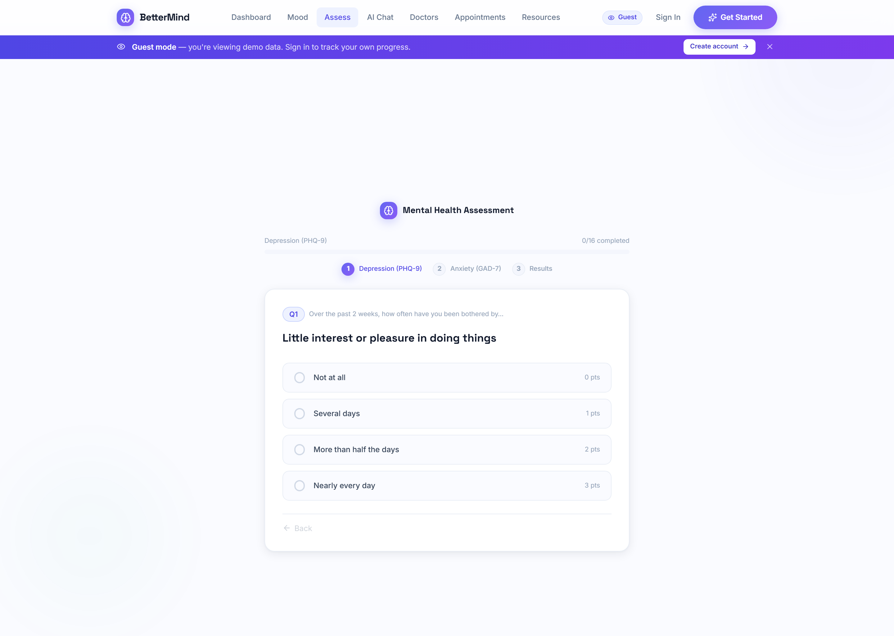
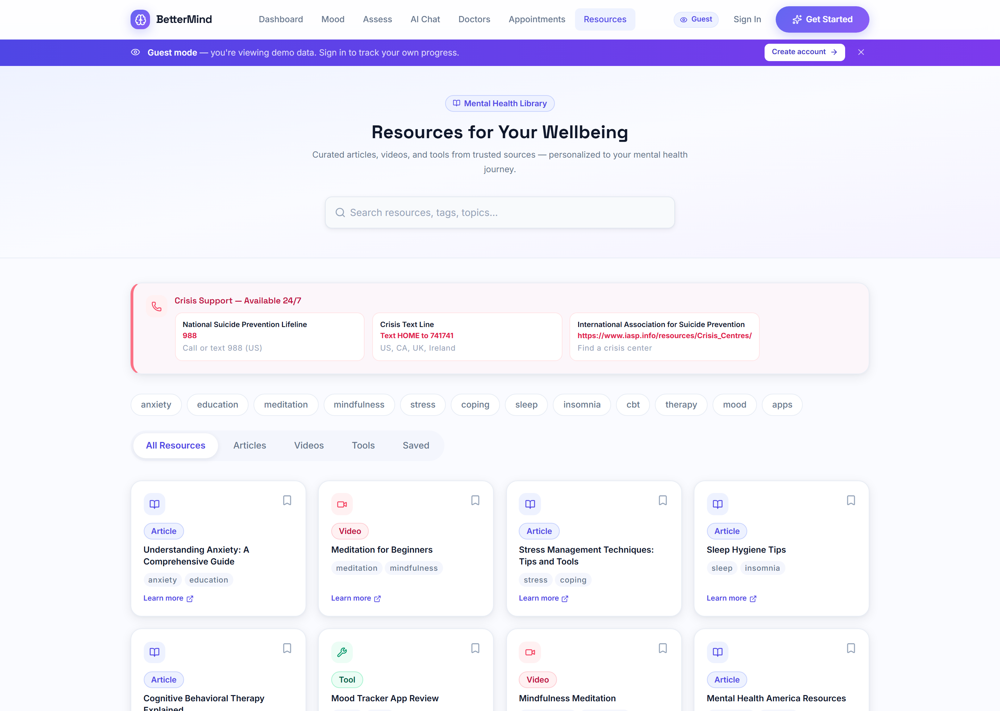

<div align="center">

# 🧠 BetterMind

### An AI-powered mental health platform — mood tracking, clinical assessments, an AI companion, and verified doctor booking, in one calm, beautiful product.

[](https://nextjs.org/)
[](https://react.dev/)
[](https://www.mongodb.com/)
[](https://tailwindcss.com/)
[](https://groq.com/)
[](https://www.framer.com/motion/)

**[Live Demo](#-guest-mode-no-sign-up-required) · [Features](#-features) · [Architecture](#-architecture) · [Tech Stack](#-tech-stack) · [Wiki](../../wiki)**

</div>

---

## Product Screenshots

### Landing Page



| Wellness Dashboard | Mood Tracker |
|---|---|
|  |  |

| Clinical Assessment | Resource Library |
|---|---|
|  |  |

---

## 📖 Overview

**BetterMind** is a full-stack mental health platform built with the Next.js App Router. It brings together the day-to-day tools people actually need for mental wellness — **daily mood logging**, **clinically-validated assessments (PHQ-9 & GAD-7)**, an **AI chat companion**, and **appointment booking with mental-health professionals** (admin-verified) — behind a single, calming, accessibility-minded interface.

It supports three distinct roles (**patient**, **doctor**, **admin**), each with its own dashboard and permissions, all secured by a custom JWT auth layer with optional **TOTP two-factor authentication**, **AES-256-GCM encryption of mood notes and assessment answers**, and **rate-limited login, 2FA, registration and chat**.

---

## 🎭 Guest Mode (no sign-up required)

Any visitor who isn't signed in is automatically in **Guest Mode** — no button to click, no opt-in required. The full platform is immediately browsable with realistic demo data: mood trends, assessment history, AI conversations, doctor listings, and appointments.

The moment a guest tries to *write* data (save a mood, book an appointment, message the AI), a modal invites them to create an account. The modal is only the friendly layer: the real guarantee is **server-side**. Every write API answers `401` to a request without a valid session (checked by the edge middleware and again in each route), so a guest cannot put anything in the database even by calling the API directly. Automated tests cover every write route.

---

## ✨ Features

### 🧑‍⚕️ For Patients
| Feature | Description |
|---|---|
| **Mood Tracking** | Log daily mood (1–10) with activities & notes; visualized as interactive trend charts |
| **Clinical Assessments** | Standardized **PHQ-9** (depression) and **GAD-7** (anxiety) with automatic severity scoring and a question-by-question history |
| **AI Companion** | Chat powered by **Llama 3.3 70B (hosted on Groq, called through the OpenAI-compatible SDK)**. The prompt includes the user's **average mood over the last 7 days** and their **latest PHQ-9 / GAD-7 scores**; a keyword-based fallback answers if the model is unavailable |
| **Insightful Dashboard** | Mood trends, assessment trends, activity-impact analysis, and mood↔severity correlation, all in light, animated Recharts visualizations |
| **Doctor Discovery & Booking** | Browse doctors by specialty, view ratings & reviews, and book real time-slots generated from each doctor's working hours |
| **Google Calendar Sync** | Appointments can optionally sync to Google Calendar via OAuth (**experimental, not verified end to end; see Known limitations**) |
| **Resource Library** | 100+ curated articles, videos & tools, filterable by tag/category, with personalized recommendations based on your assessment and mood data |

### 🩺 For Doctors
- Verification workflow (pending → approved/rejected with reason)
- Profile editor with **education, experience, and a Mon–Sun working-hours grid**
- Dashboard with patient stats, ratings, and upcoming appointments
- Patient reviews & ratings (a patient needs a confirmed or completed appointment with the doctor to review)

### 🛡️ For Admins
- Doctor verification console (approve / reject with reason)
- Tabbed views: pending, verified, rejected

---

## 🏗️ Architecture

```
┌──────────────────────────────────────────────────────────────┐
│                      Next.js 14 App Router                      │
│                                                                  │
│  Client Components (RSC-aware)        API Route Handlers          │
│  ┌────────────────────────┐          ┌────────────────────────┐ │
│  │ Pages: dashboard, mood, │  fetch   │ /api/auth/*  (JWT, 2FA) │ │
│  │ assessment, chat,       │ ───────► │ /api/mood, /assessment  │ │
│  │ doctors, appointments…  │          │ /api/chat   (LLM)       │ │
│  │                         │ ◄─────── │ /api/doctors, /appts    │ │
│  │ AuthContext (+ Guest)   │   JSON   │ /api/doctor/*, /admin/* │ │
│  └────────────────────────┘          └───────────┬─────────────┘ │
└───────────────────────────────────────────────────┼──────────────┘
                                                      │
                  ┌───────────────────────────────────┼───────────────────┐
                  │                  │                 │                    │
            ┌─────▼─────┐     ┌──────▼──────┐   ┌──────▼──────┐    ┌────────▼────────┐
            │  MongoDB   │     │    Groq     │   │ Google APIs │    │  otplib (TOTP)  │
            │ (driver)   │     │ Llama 3.3   │   │  Calendar   │    │   + AES crypto  │
            └────────────┘     └─────────────┘   └─────────────┘    └─────────────────┘
```

**Key design decisions** (details in [Technical Decisions](#-technical-decisions))
- **Custom JWT auth** (httpOnly cookie) over a heavier auth framework: full control over the 2FA challenge flow and role gating.
- **Two JWT checks:** a cheap signature check at the edge (middleware, `jose`), then a full check in each route that also confirms the user still exists (short-lived in-memory cache).
- **Fail fast on missing secrets:** `JWT_SECRET` and `ENCRYPTION_SECRET` have no defaults. The app builds without them, but refuses to authenticate or encrypt until they are set.
- **AI degrades gracefully:** the chat falls back to keyword matching when there is no API key or the model errors.
- **Guest Mode is a client-side demo; the server enforces the rules:** demo data lives in the browser, and every write route returns `401` without a session.

---

## 🛠️ Tech Stack

| Layer | Technologies |
|---|---|
| **Framework** | Next.js 14 (App Router, Route Handlers, Server/Client Components) |
| **UI** | React 18, Tailwind CSS 3, custom design-token system |
| **Animation** | Framer Motion 12 (layout animations, `AnimatePresence`, shared-layout nav) |
| **Data Viz** | Recharts 3 (area, line, bar, scatter charts) |
| **Database** | MongoDB 6 (official driver) |
| **Auth** | JWT (`jsonwebtoken`), httpOnly cookies, `bcryptjs`, **otplib** TOTP 2FA, `qrcode` |
| **AI** | `openai` SDK (OpenAI-compatible) pointed at Llama 3.3 70B on Groq, with context injection + keyword fallback |
| **Integrations** | Google APIs (`googleapis`) — Calendar sync via OAuth |
| **Security** | AES-256-GCM (per-user keys), in-memory rate limiting, role-based access control |
| **Testing** | Jest (`next/jest`), in-memory MongoDB (`mongodb-memory-server`), mocked AI client |
| **Icons** | lucide-react |

---

## 🔒 Security

- **JWT sessions** in an httpOnly, `sameSite=strict` cookie, verified at the edge and again server-side on every protected route.
- **Two-Factor Authentication (TOTP)**: enable / verify / disable with QR provisioning and one-time recovery codes (stored hashed). Login with 2FA returns **no session**; it sets a short-lived (5 min) httpOnly "2FA pending" cookie, and the session JWT is only issued after a valid TOTP or recovery code.
- **AES-256-GCM encryption at rest** for mood notes and assessment answers, with a per-user key derived from a server secret. Tampered or wrong-key data is detected and never returned as raw ciphertext.
- **Rate limiting** (reusable limiter factory, `429` + `Retry-After`):

  | Endpoint | Limit |
  |---|---|
  | Login | 5 / account and 20 / IP per 15 min (every attempt counts; a success resets the account counter) |
  | 2FA verify (TOTP and recovery codes), 2FA setup-confirm, 2FA disable | 5 / user and 20 / IP per 15 min |
  | Register | 10 / hour / IP |
  | AI chat | 30 / min / IP |

  Assessments and mood logging are **not** rate limited.
- **Role-based access control**: patient / doctor / admin checked server-side in each route handler (the role comes from the database, not from the token). Admin-only actions such as `force-verify` are `POST`s that require an authenticated admin.
- **Doctor verification**: doctors register unverified and an admin approves or rejects them. Unverified (or rejected) doctors are hidden from patients and other doctors and cannot be booked (`400`); admins and the doctor themselves can still see the profile. Doctors added by an admin are verified automatically.

---

## 🚀 Getting Started

### Prerequisites
- Node.js 18+
- A MongoDB instance (local or Atlas)
- *(Optional)* a Groq API key for the AI chat (`LLM_API_KEY`), Google OAuth credentials

### Installation

```bash
# 1. Clone
git clone https://github.com/harshcode1/BetterMind.git
cd BetterMind

# 2. Install
npm install

# 3. Configure environment — create .env.local in the project root
# (see Environment Variables section below)

# 4. Seed demo doctors (optional but recommended for a full demo)
node scripts/seed-doctors.mjs

# 5. Run
npm run dev
```

Open [http://localhost:3000](http://localhost:3000) — the platform loads in demo mode automatically if you're not signed in.

### Environment Variables

Copy [`.env.example`](.env.example) to `.env.local` and fill it in. `.env*` files are git-ignored (only `.env.example` is committed).

```bash
# Required: the app will not authenticate or encrypt without these (no built-in defaults)
MONGODB_URI=mongodb+srv://<user>:<password>@<cluster>.mongodb.net/bettermind
JWT_SECRET=<long-random-string>          # openssl rand -base64 48
ENCRYPTION_SECRET=<long-random-string>   # keep stable: changing it makes stored encrypted data unreadable

# Optional
ENCRYPTION_SALT=<short-string>           # leave unset for the built-in default; never change once data exists
LLM_API_KEY=<groq-api-key>               # AI chat (falls back to keyword matching); OPENAI_API_KEY is still read as a temporary fallback
GOOGLE_CLIENT_ID=...                     # Google Calendar sync (experimental)
GOOGLE_CLIENT_SECRET=...
GOOGLE_REDIRECT_URI=http://localhost:3000/api/auth/google/callback
```

### Testing

```bash
npm test
npm run lint
npm run build
```

Tests never touch the real database or the real AI API: MongoDB is an in-memory server started once per run (the first run downloads a `mongod` binary), route handlers are called directly with real `NextRequest` objects, and the AI client is mocked. They cover 2FA (the login, pending cookie and verify flow, recovery codes, tampering and rate limits), encryption, the edge middleware, role-based access, every write route rejecting unauthenticated requests, secrets handling, and the AI chat's personalisation and fallback.

---

## 📁 Project Structure

```
BetterMind/
├── public/                      # Static assets
├── src/
│   └── app/
│       ├── api/                 # Route Handlers (auth, mood, assessment, chat, doctors, admin…)
│       │   └── auth/2fa/        # TOTP setup / verify / disable
│       ├── components/          # Navbar, Footer, GuestBanner, GuestGateModal
│       ├── contexts/            # AuthContext (auth + guest mode + auth-gate)
│       ├── dashboard/           # Dashboard + chart components
│       ├── doctor/              # Doctor portal (dashboard, profile, verification)
│       ├── admin/               # Admin verification console
│       ├── lib/                 # db, secrets, authServer, twoFactorAuth, twoFactorPending, llmClient,
│       │                        #   chatContext, googleCalendar, slotGenerator, rateLimit, encryption, demoData
│       ├── mood/  assessment/  chat/  doctors/  appointments/  resources/  settings/
│       ├── globals.css          # Light design system (tokens, components)
│       └── layout.js
├── tests/                       # Jest tests plus helpers (in-memory DB, request builders, 2FA helpers)
├── .env.example                 # Every environment variable, no values
├── tailwind.config.js           # Extended theme (brand/mint/calm/ink scales, shadows)
└── README.md
```

📚 **Deep technical documentation lives in the [Wiki](../../wiki)** — architecture, full API reference, auth & security internals, the design system, and guest-mode internals.

---

## 🧭 Technical Decisions

**Why TOTP for 2FA.** TOTP (RFC 6238) works offline with any authenticator app, costs nothing and has no SMS/SIM-swap risk. The server keeps one shared secret per user, and setup is only confirmed once the user proves they scanned it by entering a valid code. Recovery codes (10 random `XXXXX-XXXXX` codes) are shown once, stored only as SHA-256 hashes, and consumed in a single atomic database update, so a code can never be used twice, even by two parallel requests.

**How login with 2FA stays safe.** `POST /api/auth/login` checks the password and, if 2FA is on, returns `{ requires2FA: true }` plus a signed 5-minute token in an **httpOnly, secure, `sameSite=strict` cookie scoped to `/api/auth/2fa`**. It is not in the URL or the response body, so page scripts cannot read it. The token is bound to the user, carries a `2fa-pending` purpose, and is signed with a key derived from (but different from) the session key, so it can never be used as a session and a session can never be used as a pending token. `POST /api/auth/2fa/verify` requires that cookie, takes the user only from it (a `userId` in the body is ignored), and clears it when it issues the real session.

**Encryption and key derivation.** Mood notes and assessment answers are encrypted with **AES-256-GCM**. Each user gets their own 32-byte key: `scrypt(ENCRYPTION_SECRET, salt + userId)`. GCM is *authenticated* encryption: every field has a random IV and an authentication tag, so changed ciphertext (or the wrong key) fails to decrypt instead of producing garbage. A failed decrypt is returned as `null` with `decryptionFailed: true`, never as the raw encrypted object. One master secret means rotating it requires re-encrypting existing data.

**Where the JWT is verified (edge vs route).** The edge middleware uses `jose` (the Edge runtime has no Node `crypto` or MongoDB driver) for a cheap signature and expiry check, so unauthenticated API calls get a `401` before any route code runs. `/api/auth/*` stays open at the edge because those routes do their own checks. Each route then calls `verifyAuth()` (`jsonwebtoken`), which also confirms the user still exists and loads the role from the database, so a stale role in a token cannot grant access.

**Rate limiting.** `createRateLimiter({ windowMs, max, keyPrefix })` is a small fixed-window in-memory limiter. Routes call it with an identifier (IP, account or user id), get `{ limited, retryAfter }` back, and answer `429` with `Retry-After`. Login and 2FA use two limiters at once: per account/user to stop guessing one account from many addresses, and per IP to stop one machine trying many accounts. Every attempt is counted (so a lock cannot be probed), and a success resets only the per-account counter. The 2FA limit is keyed by user id, so logging in again does not reset it.

**Guest Mode.** Demo data is generated in the browser (`lib/demoData.js`) and a guest is simply "not signed in". Write buttons call `requireRealUser()` to show a sign-up prompt, but the rule that guests cannot write is enforced by the server: every write route returns `401` without a valid session. A test walks every write route (and fails if a new one is added without coverage) to prove nothing reaches the database.

**Fail-fast secrets.** `JWT_SECRET` and `ENCRYPTION_SECRET` have no default values anywhere in the source. They are read when first needed (so `next build` works without them), and a missing secret throws instead of silently falling back to a key that would be public in the repository.

---

## ⚠️ Known limitations

- **Rate limits are in memory.** On serverless hosting (e.g. Vercel) they reset on cold starts and are not shared between instances. A shared store such as Redis would fix this; it is intentionally not added.
- **The per-account login lock can be abused** to lock a victim out for 15 minutes (the usual trade-off for per-account limits).
- **5-minute auth cache.** `verifyAuth` caches results per token, so a deleted or demoted user can keep access for up to 5 minutes.
- **Logout does not revoke tokens** and is a `GET`. It clears the cookie, but a copied JWT stays valid until it expires (7 days).
- **TOTP secrets are stored unencrypted** in MongoDB, a valid TOTP code can be reused within its 30-second window (no replay protection), and the 10-character recovery codes (about 40 bits) are hashed with plain SHA-256, which would be quick to brute-force offline if the database leaked.
- **Existing 2FA accounts were not migrated.** Before the 2FA fix, enabling 2FA accepted any code, so some accounts may have it enabled without ever having scanned the QR code. They can sign in with a recovery code, or have `twoFactorAuth` reset in the database.
- **Encryption covers mood notes and assessment answers only.** AI chat messages and other profile fields are stored unencrypted.
- **Google Calendar sync is not verified end to end** and probably does not work in a real browser: the session cookie is `sameSite=strict` (so it is not sent on Google's redirect back to the callback), and the callback stores `googleTokens.userId` as a string while some routes look it up as an ObjectId.

---

## 🗺️ Roadmap

- [ ] Real-time doctor↔patient messaging (WebSockets)
- [ ] Push/email reminders for appointments and check-ins
- [ ] Exportable PDF wellness reports
- [ ] Mobile app (React Native) sharing the same API
- [ ] Expanded assessment library (PSS, WHO-5)

---

## 🤝 Contributing

1. Fork the repo
2. Create a feature branch (`git checkout -b feature/amazing-feature`)
3. Commit (`git commit -m 'Add amazing feature'`)
4. Push (`git push origin feature/amazing-feature`)
5. Open a Pull Request

## 📄 License

Licensed under the MIT License — see `LICENSE` for details.

---

<div align="center">
<sub>Built with care for mental wellness. 🧠💙</sub>
</div>
